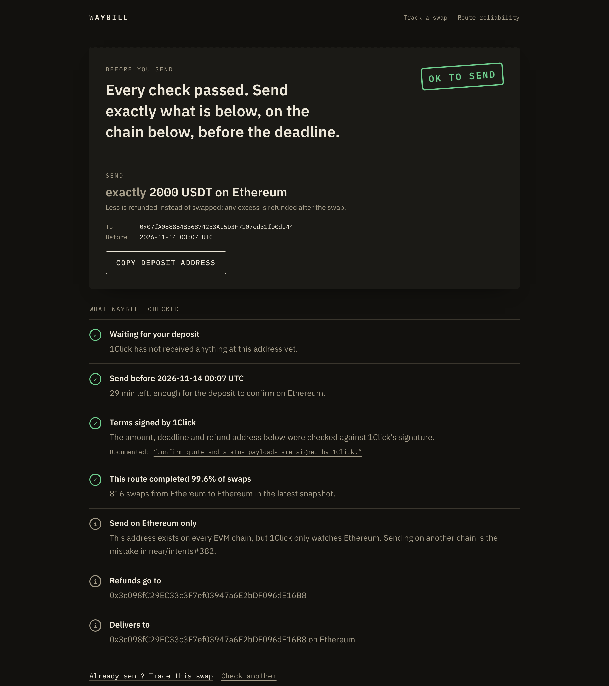
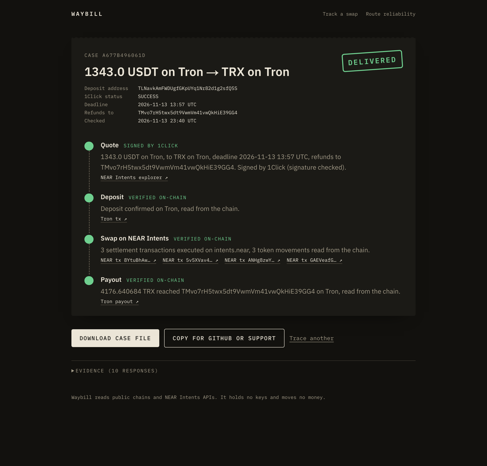
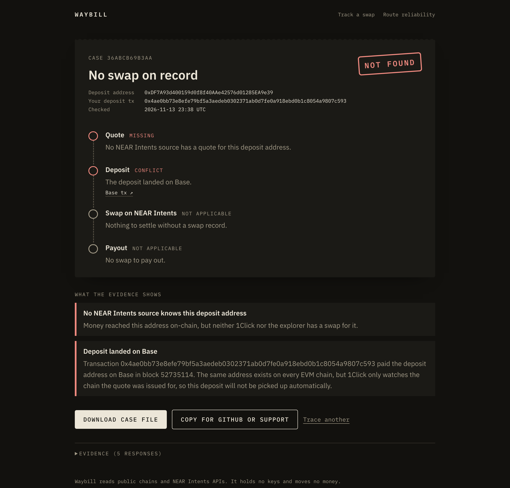
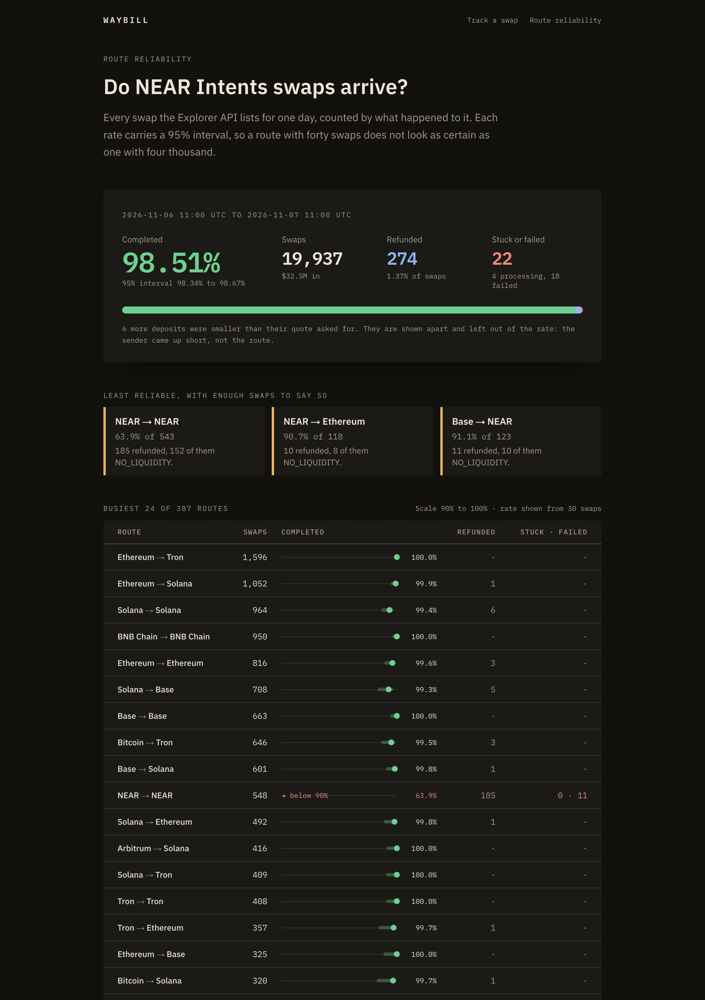
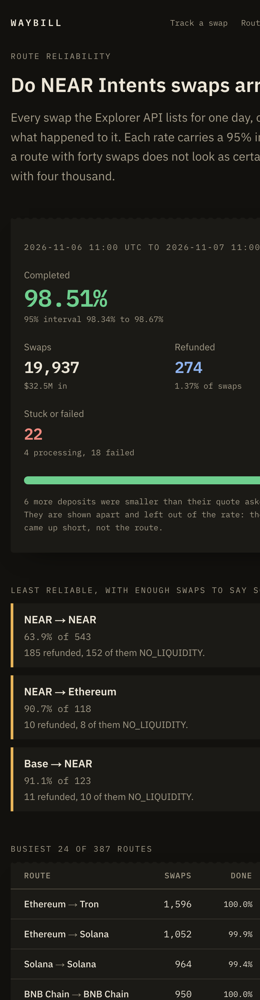
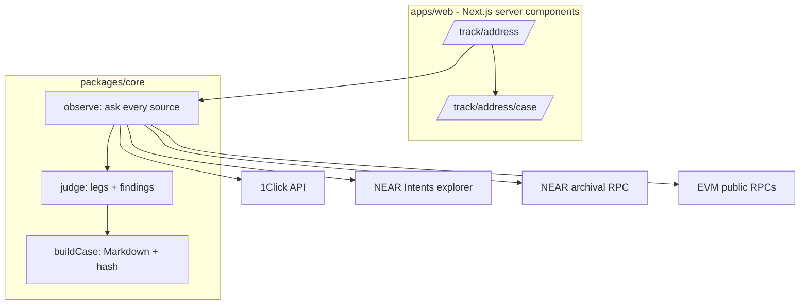

# Waybill


-blue)


**Where is my swap? Checked before you send, read from the chains after.**

When a NEAR Intents swap stalls, the user gets one status string and a support queue.
Waybill takes one deposit address and answers three questions from evidence, not from a status field:

- *Before sending:* is this address safe to pay, and exactly what should I send, on which chain, by when?
- *After sending:* where is the money? Each leg (quote, deposit, settlement on NEAR, payout) is read on its own chain: eight EVM chains, Bitcoin, Solana, Tron, TON and NEAR.
- *Choosing a route:* how often does this route actually complete? A full day of real swaps, 19,937 of them, per chain route.

When a documented promise is broken, Waybill writes a case file with every response it used, hashed, ready to paste into a support ticket or a GitHub issue.

Live frontend: https://waybill-gules.vercel.app · Backend: none, read-only server components · Contracts: none, Waybill only reads.

**Try it live:** [check an address before sending](https://waybill-gules.vercel.app) · [a delivered Tron swap, every leg verified](https://waybill-gules.vercel.app/track/TLNavkAmFWDUgfGKpUYq1Nr82d1g2sfQ5S) · [near/intents#382, money sent on the wrong chain](https://waybill-gules.vercel.app/track/0xDF7A93d400159d0f8f40AAe42576d01285EA9e39?tx=0x4ae0bb73e8efe79bf5a3aedeb0302371ab0d7fe0a918ebd0b1c8054a9807c593) · [route reliability](https://waybill-gules.vercel.app/routes)

[See it in one command](#see-it-in-one-command) · [The one rule](#the-one-rule) · [What Waybill does](#what-waybill-does) · [What's real vs pending](#whats-real-vs-pending) · [The one-flow demo](#the-one-flow-demo)

Built for NEAR HACKATHON 2026 (tracks: `defi`, `thesis`, `open`), MIT licensed.
Waybill holds no keys, moves no money and cannot recover funds; it only reads public data and reports what it found.

## Table of contents

- [See it in one command](#see-it-in-one-command)
- [Screenshots](#screenshots)
- [The one rule](#the-one-rule)
- [What Waybill does](#what-waybill-does)
  - [Check before sending](#check-before-sending)
  - [Trace a swap](#trace-a-swap)
  - [Find a wrong-chain deposit](#find-a-wrong-chain-deposit)
  - [Check the quote signature](#check-the-quote-signature)
  - [Write the case file](#write-the-case-file)
  - [Measure route reliability](#measure-route-reliability)
- [Architecture](#architecture)
- [Component by component](#component-by-component)
- [Safety, enforced in code](#safety-enforced-in-code)
- [How it uses NEAR](#how-it-uses-near)
- [Engineering decisions & the hard problems](#engineering-decisions--the-hard-problems)
- [What's real vs pending](#whats-real-vs-pending)
- [Tests](#tests)
- [Run it locally](#run-it-locally)
- [The one-flow demo](#the-one-flow-demo)
- [Configuration](#configuration)
- [Deploy](#deploy)
- [Project layout](#project-layout)
- [Tech stack, credits, roadmap](#tech-stack-credits-roadmap)
- [Disclaimer & license](#disclaimer--license)

## See it in one command

```bash
cd Waybill
pnpm install && pnpm trace 0xDF7A93d400159d0f8f40AAe42576d01285EA9e39 0x4ae0bb73e8efe79bf5a3aedeb0302371ab0d7fe0a918ebd0b1c8054a9807c593
```

```bash
cd Waybill
pnpm dev  # http://localhost:3020
```

The first command traces the deposit from [near/intents#382](https://github.com/near/intents/issues/382) against live mainnet sources and prints each leg and finding.
The second starts the web app; open it and pick one of the real cases on the home page.

## Screenshots

Captured from the live deployment on 2026-11-14, against real mainnet swaps.











## The one rule

**Every claim points at a response Waybill fetched itself, and a leg is only "verified" when Waybill read it from a chain or checked a signature.**

1. *Evidence capture* - every HTTP and RPC response is stored as received, with its URL, time and SHA-256 (`packages/core/src/evidence.ts`).
2. *Leg states* - a leg is `verified` only from an on-chain read or a valid 1Click signature; an API statement alone is `reported` (`packages/core/src/legs.ts`).
3. *Findings* - rules state what the evidence shows and the documented promise it breaks, never a guessed cause (`packages/core/src/rules.ts`).

## What Waybill does

### Check before sending

Paste a deposit address and choose "Check before sending" (`/check/<address>`).
Waybill reads the quote 1Click signed and answers with one verdict, OK to send, Check first or Do not send, and the exact instruction: how much, of which token, on which chain, to which address, before when.

```text
Send exactly 22076.475458 USDC on Arbitrum
To 0x8029d95FD6aa7042164Ec8399Ea72Fc73cA9d4d7, before 2026-11-12 10:46 UTC
```

It stops a sender when the address was already used, the quote's deadline passed, or the address went inactive; warns when too little time is left for the deposit to confirm on its chain, when a memo is required, or when the route often refunds; and notes that an EVM deposit address is watched on one chain only, the mistake in near/intents#382.
The amount follows the quote's swap type: exactly `amountIn` for `EXACT_INPUT`, at least `minAmountIn` for `EXACT_OUTPUT` and `FLEX_INPUT`.

### Trace a swap

Given a deposit address, Waybill asks every source in parallel and keeps one record per source instead of merging them.

```text
1Click status  ─┐
Explorer API   ─┼─> records ─> legs (quote, deposit, settlement, payout) + findings
Explorer page  ─┘      │
                       └─> NEAR settlement txs (intents.near events) + origin/destination chain receipts
```

Deposits and payouts are read on their own chains: eight EVM chains, Bitcoin, Solana, Tron and TON.
A payout is only "verified" when the transaction is final and delivered the quoted token to the quoted recipient; a final transaction that paid someone else, or in another token, is a critical finding.

Settlement is read from `intents.near` events (`dip4` `intents_executed`, `nep245` `mt_transfer`) through an archival NEAR RPC, so a SUCCESS that never paid the recipient is caught.

### Find a wrong-chain deposit

An EVM deposit address is valid on every EVM chain, but 1Click only watches the one in the quote.
Given the user's transaction hash, Waybill looks it up on eight EVM chains and reports where the money actually landed.
This finds #382 (ETH sent on Base for an Ethereum quote), which the explorer does not index at all.

### Check the quote signature

1Click signs quotes with an ed25519 key, and the status response embeds the signed quote.
Waybill verifies it with the official SDK, so the deadline and refund address are proven to be 1Click's own terms.
A failed check is reported as "unverified", not "forged": some live status payloads do not hash to their signature under the SDK scheme.

### Write the case file

```bash
curl "http://localhost:3020/track/<depositAddress>/case?tx=<depositTx>"  # Markdown download
```

The case file lists what the quote promised, each finding with the documented rule it breaks, the legs, and every evidence row with its SHA-256.
Its case hash covers the evidence hashes and findings, so an edited packet is detectable.

### Measure route reliability

```bash
cd Waybill
pnpm routes:collect --hours 24 --settle 2  # needs NEAR_INTENTS_JWT, about ten minutes
```

The collector pages through every funded swap the Explorer API lists for a 24-hour window and writes `data/routes/snapshot.json.gz`.
The window closes two hours before collection, so a swap still `PROCESSING` had at least two hours to finish and is counted as stuck.
`/routes` shows, per origin and destination chain, how many swaps completed, were refunded, stuck or failed, each completion rate with a 95% Wilson interval, why refunds happened, and every stuck or failed swap as a link into the tracker.
The snapshot keeps the SHA-256 of every API page it was built from, and deposit addresses only for swaps that did not succeed.

The committed snapshot covers 2026-11-06 11:00 to 2026-11-07 11:00 UTC: 19,937 swaps across 387 chain routes, 98.51% completed (95% interval 98.34% to 98.67%), 274 refunded, 18 failed and 4 still processing after at least two hours.
Most busy routes sit between 99% and 100%; the clear outlier is NEAR to NEAR at 63.9% of 543, where 152 of 185 refunds were `NO_LIQUIDITY`.

## Architecture

**Decision one: read-only.** Waybill has no wallet, no keys and no write path; it cannot make a stuck swap worse.
**Decision two: compare, do not merge.** Each source keeps its own record, so a disagreement between 1Click and the explorer is itself a finding.



| Tier | Runs | Can it move funds? | Responsibility |
| --- | --- | --- | --- |
| `packages/core` | Node, server-side | No | Fetch, parse, reconcile, judge, write the case |
| `apps/web` | Next.js server | No | Render the tracker, serve the case download |
| `scripts/` | Local CLI | No | Trace from the terminal, record fixtures |

## Component by component

| Module | Responsibility |
| --- | --- |
| `evidence.ts` | Fetch a URL and keep the raw response, time and SHA-256 |
| `sources/oneclick.ts` | 1Click status (signed quote, tx hashes) and the public token list |
| `sources/explorer.ts` | Explorer API search and history pages (JWT) and the public explorer page fallback |
| `sources/near-rpc.ts` | NEAR transactions and their `intents.near` events and token movements |
| `sources/chains.ts` | The one transaction shape every chain reader returns, address normalization, `paidTo` |
| `sources/chain-read.ts` | Picks the reader for a chain and asset; says when Waybill cannot read one |
| `sources/evm-rpc.ts` | Receipts on eight EVM chains, native and ERC-20 transfers to an address |
| `sources/btc.ts` | Bitcoin transactions from mempool.space: confirmation and outputs |
| `sources/solana.ts` | Solana transactions (including version 1) from the public RPC: SOL and SPL balance increases by owner |
| `sources/tron.ts` | Tron from TronGrid: native TRX transfers and TRC-20 Transfer logs, hex to base58check addresses |
| `sources/ton.ts` | TON from toncenter: the recipient wallet's credit, raw and user-friendly addresses |
| `verify.ts` | Quote signature check through the official 1Click SDK |
| `legs.ts` | Quote, deposit, settlement, payout states from the observations |
| `rules.ts` | Findings: deadline passed, PROCESSING with no intent, wrong chain, paid elsewhere, private leg |
| `case.ts` | The Markdown case file and its hash |
| `presend.ts` | The pre-send verdict, instruction and checks for an unfunded quote |
| `routes.ts` | Route snapshot format, per-route outcomes and Wilson intervals |
| `trace.ts` | `observe` (gather) and `judge` (decide), kept separate so judging is pure and testable |
| `replay.ts` | Record and replay real HTTP traffic for tests |

## Safety, enforced in code

| Claim | How it's enforced |
| --- | --- |
| Waybill cannot move funds | No signer, key or write call exists in the codebase |
| A partner JWT never leaks into evidence | Headers are sent but never stored; evidence keeps URL, request body and response only |
| An API statement is never shown as proof | `reported` vs `verified` leg states; only on-chain reads and valid signatures verify |
| A failed signature check is not an accusation | `SignatureCheck` is `valid`, `unverified` or `absent`, and `unverified` is an info finding |
| Tests do not hit the network | `replayFetch` throws on any request that was not recorded |
| A route rate never overstates a small sample | Rates show from 30 complete deposits, always with a 95% interval |

## How it uses NEAR

**Reads:** `EXPERIMENTAL_tx_status` on an archival RPC for settlement transactions; `intents.near` events (`dip4`, `nep245`); NEAR Intents 1Click status, tokens and Explorer APIs.
**Writes:** none yet. A stretch goal is a small contract that anchors each case hash and filing time on NEAR.
The Confidential Intents treasury (`51e8f94d…7cbe`, `PRIVATE_TREASURY_ACCOUNT_ID` in the [docs](https://docs.near-intents.org/integration/market-makers/confidential-intents)) is treated as the end of the public trail, not as a wrong recipient.

## Engineering decisions & the hard problems

**1Click status is partner-scoped.** Without the quoting partner's key, `GET /v0/status` answers 404 for many swaps, so a 404 is not proof the swap is unknown; Waybill falls back to the explorer and says which sources knew the swap.

**The public explorer page is a fallback, not an API.** It server-renders the swap as `initialItem` inside the RSC payload; Waybill parses it with a string-aware brace matcher and labels it as the least authoritative source.

**Two deadlines exist.** The request's `deadline` and the quote's `deadline` (when the deposit address may stop working) differ; Waybill uses the quote's, the later and more conservative one, before calling a swap overdue.

**The Explorer API is not the whole picture.** By default it hides `PENDING_DEPOSIT` and `INCOMPLETE_DEPOSIT`, so the tracker asks for every status; and it does not list Confidential Intents swaps at all (near/intents#384 is on the public explorer page but absent from the API), so route statistics cover public swaps only.
It also has no completion time, so Waybill reports outcomes per route, not durations.

**A failed read is not a missing transaction.** Public RPCs fail, rate-limit and change (Solana started serving version 1 transactions, which older clients are refused); every reader throws on an RPC error, so it shows as a source failure instead of "the chain does not have this transaction".

**Each chain says "paid" differently.** Solana tokens are credited to a token account, so Waybill matches the account's owner; Tron logs carry hex addresses, converted to the `T…` base58check form; a TON payout to a new wallet is marked aborted yet credited, so Waybill counts the credit and treats only a bounce as failure.

**Fixtures are recorded, not written.** `pnpm fixtures:record` captures real mainnet responses; tests replay them, so they fail if parsing drifts from what the services really return.
The recorder retries a case whose sources failed and refuses to save it if they keep failing, so a fixture never bakes in a flaky node.

## What's real vs pending

| Capability | Status |
| --- | --- |
| Trace by deposit address against live 1Click, explorer, NEAR and EVM sources | Real - runs against mainnet |
| Wrong-chain deposit detection from a tx hash | Real - finds #382 on Base |
| NEAR settlement verification from `intents.near` events | Real - read from archival RPC |
| Quote signature verification | Real - verifies on some live swaps; others are reported "unverified" (open question below) |
| Case file download with evidence hashes | Real |
| Explorer API lookup of any swap | Real - tested with a partner JWT on 2026-11-07 |
| Route reliability from a day of Explorer API history | Real - `pnpm routes:collect`, rendered at `/routes` |
| Payout verification on EVM chains, Bitcoin, Solana, Tron and TON: right recipient, right token, amount | Real - read from each chain |
| Deposit verification on the same chains | Real - read from each chain |
| TON jetton (for example USDT on TON) payouts | Not yet established - reported, not verified |
| Pre-send check of a deposit address against its signed quote | Real - `/check/<address>`, tested on recorded live quotes |
| Watch mode and alerts | Not yet established |
| NEAR AI Cloud plain-language summary | Not yet established |
| On-chain case anchoring | Not yet established |

The pre-send check treats a signature that is present but fails this check as a note, not a warning: about half of genuine live quotes fail it, and no signed field or value separates them from those that pass.
A quote with no signature at all is still a warning.

Open question: why some status-embedded quotes do not verify with `verifyQuoteSignature` from `@defuse-protocol/one-click-sdk-typescript@0.1.26` while others do.

## Tests

| Suite | Tests | Covers |
| --- | --- | --- |
| `trace.test.ts` | 10 | Recorded mainnet cases: #384, #382, a signed refund, payouts read on Tron, Bitcoin, Solana, Tron (TRX) and TON, a Solana v1 deposit, case hash |
| `rules.test.ts` | 6 | #399's shape (rebuilt from the issue text), grace period, terminal states, disagreement, wrong recipient on NEAR and on Bitcoin |
| `presend.test.ts` | 6 | Recorded unfunded quotes: fresh, minutes left, expired; a used address, #382, an unreliable route |
| `chains.test.ts` | 5 | Tron base58check, TON raw addresses, case folding per chain, `paidTo` by recipient and asset |
| `swap.test.ts` | 4 | Asset chain mapping, explorer page record extraction |
| `routes.test.ts` | 5 | Wilson interval, route grouping, incomplete deposits kept out of rates, de-duplication, snapshot encoding |

```bash
cd Waybill
pnpm test && pnpm typecheck && pnpm lint && pnpm build
```

All four pass as of 2026-11-13.

## Run it locally

### 1. Install

```bash
cd Waybill
pnpm install  # Node 24+, pnpm 12
```

### 2. Optional partner key

```bash
cd Waybill
cp .env.example .env.local  # then set NEAR_INTENTS_JWT from partners.near-intents.org
```

### 3. Start

```bash
cd Waybill
pnpm dev  # http://localhost:3020
```

## The one-flow demo

1. Open http://localhost:3020, paste a fresh deposit address from any NEAR Intents wallet and choose "Check before sending" to see what to send, where and by when.
2. Back on the home page, paste `0xDF7A93d400159d0f8f40AAe42576d01285EA9e39` and the transaction `0x4ae0bb73e8efe79bf5a3aedeb0302371ab0d7fe0a918ebd0b1c8054a9807c593`.
3. See the stamp "Not found", the Deposit leg in conflict with a Basescan link, and the finding "Deposit landed on Base".
4. Click "Download case file" and see the Markdown packet with every response's SHA-256.
5. Open http://localhost:3020/routes and see a day of swaps per route; click any stuck swap to trace it.

## Configuration

| Variable | Purpose |
| --- | --- |
| `NEAR_INTENTS_JWT` | Partner JWT: enables the Explorer API and partner-scoped 1Click status |
| `NEAR_AI_API_KEY` | NEAR AI Cloud key for the plain-language case summary (not used yet) |
| `NEAR_RPC_URL` | Overrides the archival NEAR RPC (default `archival-rpc.mainnet.fastnear.com`) |

## Deploy

Production runs on Vercel at https://waybill-gules.vercel.app, deployed from `main` with the root directory set to `apps/web` and Node 24.
The route page is prerendered at build time from `data/routes/snapshot.json.gz`; traces run live on each request.
Any Node host that runs Next.js works; set the variables above in its environment.

## Project layout

```text
Waybill/
  packages/core/
    src/            sources, legs, rules, case, trace (tests next to the code)
    fixtures/       recorded mainnet responses for the test cases
  data/routes/      snapshot.json.gz: a day of Explorer API history for /routes
  apps/web/         Next.js tracker: /, /check/[address], /track/[address], /track/[address]/case, /routes
  scripts/          trace.ts (CLI), record-fixtures.ts, collect-routes.ts
```

## Tech stack, credits, roadmap

### Tech stack

TypeScript, Next.js 16, React 19, Tailwind CSS 4, Zod, Vitest, the 1Click TypeScript SDK (signature check only), public NEAR and EVM RPCs.

### Credits

The real cases come from public reports in [near/intents](https://github.com/near/intents/issues): #382, #384 and #399.
No code from earlier projects is reused; all code was written during the hackathon window.

### Roadmap

1. Payout reads for TON jettons.
2. Refunds read on the origin chain.
3. NEAR AI Cloud summary where every sentence cites an evidence row.
4. Case hashes anchored on NEAR.
5. Watch mode for wallets: alert when a swap passes its deadline, case file attached.

## Disclaimer & license

Waybill reports what public sources returned at a stated time; it is not affiliated with NEAR Intents, cannot recover funds, and its findings are not legal or financial advice.

**MIT licensed.**
